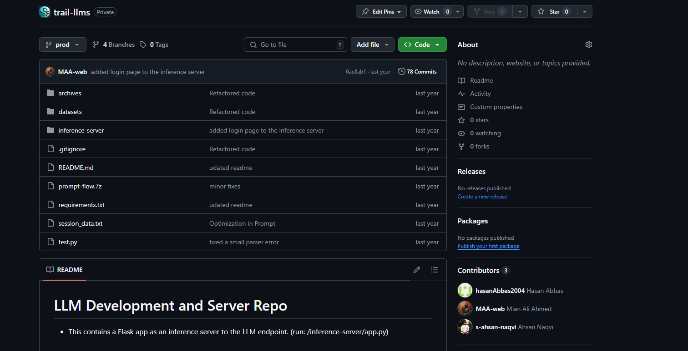

# AI Career Counsellor

**Conversational career guidance powered by LLMs.** The system talks with a user to uncover their skills, interests and strengths, then recommends career paths that fit them.

> Source code is private under an NDA. This repository documents the project and my role in it.

*The private source repository, shared as a snapshot because the code is under NDA.*

## My role: main AI engineer

This was a 3-person team project. I was the main AI engineer and owned the LLM side of the system:

- **Model selection and integration:** open-source LLMs (Mixtral-8x7B, Mistral 7B) through Hugging Face
- **Prompt engineering:** dynamic prompts that adapt to the user's previous answers, few-shot examples, and chain-of-thought prompting to make career assessments relevant
- **Conversation flow:** the LangChain pipeline that runs the talent-discovery dialogue and turns it into a structured profile
- **Inference server:** the Flask server that exposes the LLM endpoint to the app

## How it works

1. **Discover:** an LLM-driven chat asks open questions and adapts its follow-ups to uncover skills, interests and personality traits.
2. **Analyze:** the conversation is turned into a structured profile of the user's strengths.
3. **Recommend:** the profile feeds a neural career-matching model (maintained in a separate repository), which suggests careers with an explanation of why each one fits.

## Features

- **LLM-powered chat interface** that engages users in natural conversation
- **Adaptive questioning** based on the user's earlier answers
- **Few-shot prompting** to keep assessments consistent and relevant
- **Explainable recommendations:** each suggested career comes with the reasoning behind it
- **API-first design:** a Flask inference server so web or mobile apps can integrate it

## Tech stack

| Area | Tools |
|---|---|
| LLMs | Mixtral-8x7B, Mistral 7B (Hugging Face) |
| Orchestration | LangChain |
| Prompting | Dynamic prompts, few-shot examples, chain-of-thought |
| Serving | Flask inference server |
| Career matching | Neural network model (separate repository) |
